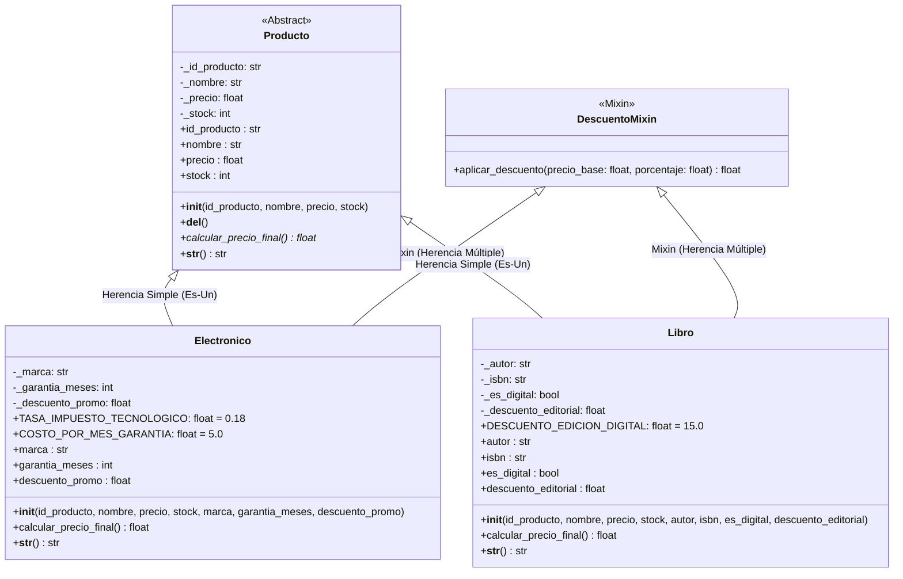

# Sistema de Gestión de Productos (CLI) - POO en Python

**Asignatura:** Desarrollo de Aplicaciones Web (IS093A)  
**Unidad II:** Desarrollo Web Fullstack  
**Tema:** Lenguaje Python: Sintaxis, Estructuras de Control, POO (Clases, Herencia, Polimorfismo, Encapsulamiento), Excepciones y Módulos  
**Fecha:** 04/11/2026  

---

## 👥 Integrantes del Equipo

| Integrante | Rol Principal | Responsabilidades |
| :--- | :--- | :--- |
| **ROJAS CERRON ZAIR KEN** | **Arquitecto POO & Documentador** | Jerarquía de clases (`Producto`, `Electronico`, `Libro`, `DescuentoMixin`), encapsulamiento con `@property`, polimorfismo (`calcular_precio_final`), control de MRO, destructores y documentación UML. |
| **TOCAS ANGLAS ANGEL** | **Ingeniero de Validaciones & Lógica CLI** | Excepciones personalizadas (`ValidationError`, `NotFoundError`), sanitización/validación de datos, flujo de control CLI (`main.py`) con bloques `try/except/else/finally` y capturas de prueba. |

---

## 🏗️ 1. Diagrama de Clases UML

A continuación se presenta el diagrama de clases modelado con la jerarquía POO, encapsulamiento estricto y herencia múltiple mediante Mixins:



---

## 🧬 2. Explicación de MRO (Method Resolution Order)

En Python, la herencia múltiple se gestiona mediante el algoritmo de **Linearización C3**, el cual garantiza que una clase siempre preceda a sus padres y que el orden local de precedencia de los ancestros se preserve sin ambigüedades.

Para las clases `Electronico` y `Libro`:
```python
class Electronico(Producto, DescuentoMixin):
    ...
```

El orden de resolución de métodos (MRO) generado es:
1. `models.producto.Electronico`
2. `models.producto.Producto`
3. `abc.ABC`
4. `models.producto.DescuentoMixin`
5. `builtins.object`

### Comprobación vía introspección de Python:
```python
>>> from models.producto import Electronico
>>> Electronico.mro()
[
    <class 'models.producto.Electronico'>,
    <class 'models.producto.Producto'>,
    <class 'abc.ABC'>,
    <class 'models.producto.DescuentoMixin'>,
    <class 'object'>
]
```

### ¿Por qué este orden?
- `super().__init__(...)` en `Electronico` busca primero en `Producto`, permitiendo la correcta inicialización de los atributos base protegidos (`_id_producto`, `_nombre`, `_precio`, `_stock`) y la validación en sus respectivos setters.
- El mixin `DescuentoMixin` se ubica tras la jerarquía de producto, aportando métodos utilitarios de comportamiento (`aplicar_descuento`) sin colisionar con el estado ni con los constructores de `Producto`.

---

## ⚖️ 3. Justificación Técnica: Herencia vs. Composición

En el diseño de este sistema se adoptó un enfoque híbrido fundamentado en principios de diseño orientado a objetos:

1. **Herencia Jerárquica (`Producto` -> `Electronico` / `Libro`):**
   - **Criterio "Es-Un" (Is-A):** Un televisor o laptop *es un* producto tecnológico; una novela *es un* producto bibliográfico. Comparten identidad de dominio: tienen SKU/ID, nombre comercial, costo base e inventario físico.
   - **Principio de Sustitución de Liskov (LSP):** Cualquier función o módulo del sistema (como el inventario en el CLI o el generador de reportes) puede manipular objetos `Producto` y llamar a `calcular_precio_final()` o `__str__()` de forma polimórfica sin conocer la subclase concreta.

2. **Composición / Mixin (`DescuentoMixin`):**
   - **Reutilización de Comportamiento sin Acoplamiento Vertical:** La capacidad de aplicar porcentajes promocionales no define la esencia de un producto (no todo producto requiere promociones, ni las promociones son exclusivas de productos).
   - En lugar de forzar una jerarquía rígida o inflar la clase base abstracta `Producto` con métodos promocionales que no todas las subclases futuras requerirían, se modularizó en un **Mixin independiente**.

---

## 🛡️ 4. Encapsulamiento y Validaciones

Cada atributo crítico está protegido por convención (`_atributo`) y expuesto a través de decoradores `@property`:
- **`precio`**: Valida que sea estrictamente mayor a 0 (`precio > 0.0`), impidiendo la creación o actualización de productos con valores nulos o negativos.
- **`stock`**: Valida que sea un entero no negativo (`stock >= 0`).
- **`nombre` / `id_producto`**: Valida que no sean cadenas vacías o solo espacios en blanco.

Si una validación falla, se lanza una excepción de dominio `ValidationError`.

---

## 📂 5. Modularización del Proyecto

```text
PRACTICA-SEM-10-AGUILAR1/
├── models/
│   ├── __init__.py          # Exportación limpia de la capa de entidades
│   └── producto.py          # Producto, Electronico, Libro, DescuentoMixin
├── utils/
│   ├── __init__.py          # Exportación de utilitarios
│   ├── exceptions.py        # ValidationError, NotFoundError
│   └── validators.py        # Sanitizadores y validadores de consola
├── main.py                  # Orquestador del CLI con try/except/else/finally
├── requirements.txt         # Especificación de versión Python (>=3.11)
└── README.md                # Documentación técnica, UML, MRO y evidencias
```

---

## 🚀 6. Guía de Ejecución

### Requisitos Previos
- Python 3.11 o superior instalado.

### Ejecución de la Aplicación
```bash
python main.py
```

---

## 📸 7. Evidencias de Ejecución (Capturas)

> *Sección completada durante la integración de pruebas por Tocas Anglas Angel.*

### Caso 1: Flujo Exitoso (Ruta Feliz)
*Registro de productos Electrónico y Libro, y listado polimórfico con cálculo de precios finales.*
*(Adjuntar captura: `docs/screenshots/caso_exitoso.png`)*

### Caso 2: Excepción Capturada 1 (`ValidationError`)
*Intento de registrar un producto con precio `<= 0` o stock negativo, capturado por el bloque `try/except`.*
*(Adjuntar captura: `docs/screenshots/error_validation.png`)*

### Caso 3: Excepción Capturada 2 (`NotFoundError`)
*Búsqueda o actualización de un ID de producto inexistente en el inventario.*
*(Adjuntar captura: `docs/screenshots/error_not_found.png`)*
